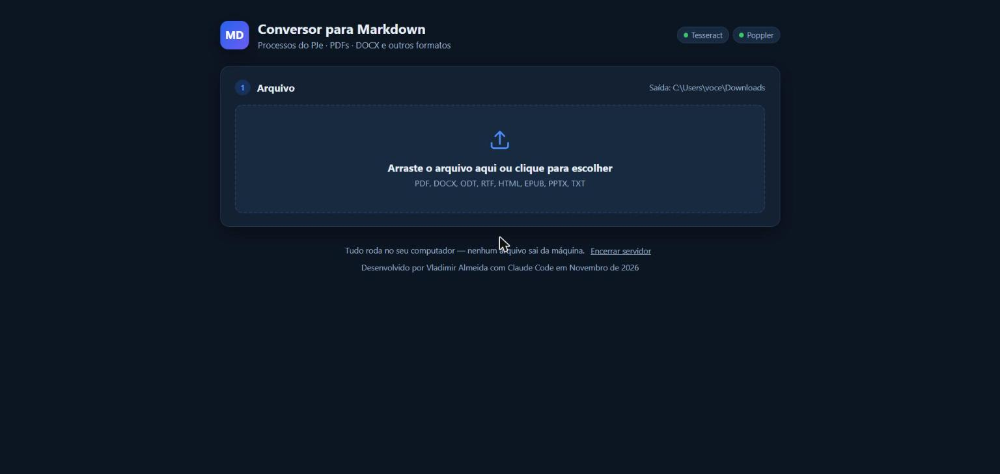
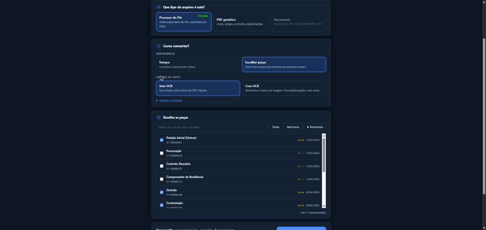
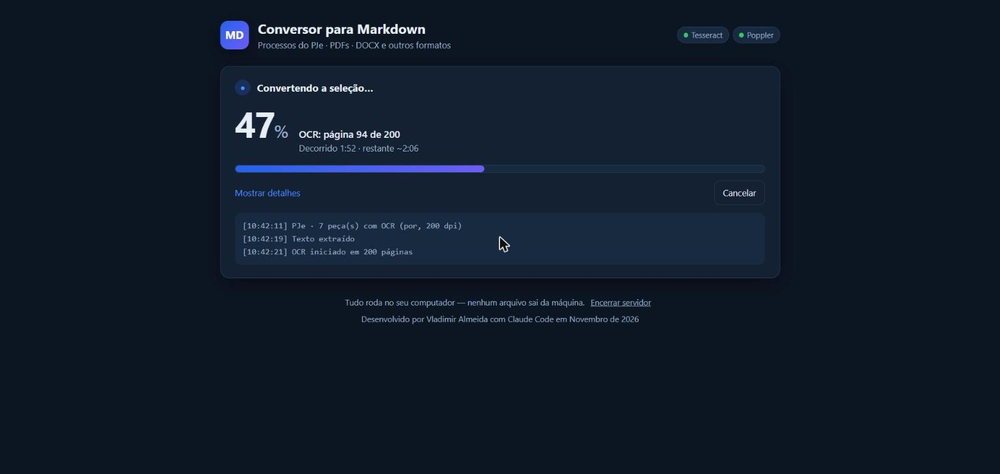
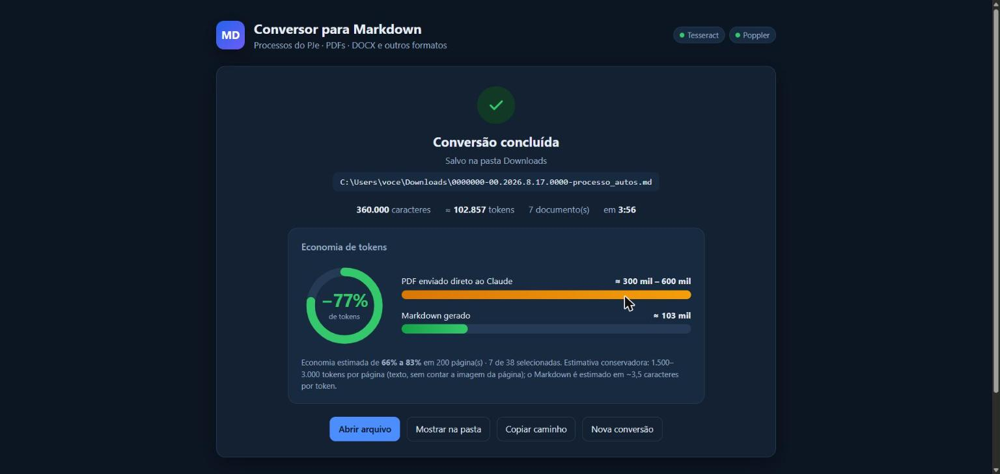

# Conversor para Markdown

Interface web local para converter em Markdown:

- **Processos do PJe** (PDF exportado do PJe): íntegra ou peças escolhidas, com ou sem OCR.
- **PDFs genéricos** (livros, artigos, contratos, digitalizações): íntegra ou capítulos escolhidos, com ou sem OCR.
- **DOCX, ODT, RTF, HTML, EPUB, PPTX e TXT**: conversão direta.

Tudo roda na sua máquina (`http://127.0.0.1:8477`); nenhum arquivo é enviado à internet. O resultado é salvo na pasta **Downloads**, com painel de progresso em percentual.

## Telas

*Capturas com dados fictícios.*

**1. Escolha do arquivo** — arraste ou selecione PDF, DOCX e outros formatos.

**2. Tipo, abrangência, OCR e seleção de peças** — com relevância em estrelas para processos do PJe.

**3. Acompanhamento da conversão** — percentual real, etapa, tempo restante e cancelamento.

**4. Resultado** — arquivo `.md` salvo em Downloads, com gráfico de **economia estimada de tokens** (anel e barras) em relação a enviar o PDF direto ao Claude.

### Como a economia de tokens é estimada

O cálculo é local e conservador: PDF com texto ≈ 1.500–3.000 tokens por página (sem contar a imagem da página); PDF digitalizado ≈ 1.200–2.000 por página. O Markdown é estimado em ~3,5 caracteres por token. Na conversão de peças ou capítulos selecionados, a comparação considera apenas as páginas das peças escolhidas. São estimativas, não contagens exatas; o gráfico não aparece para DOCX e demais formatos de texto.

## Instalação (Windows)

1. Instale o **Python 3.10+** (marque *Add python.exe to PATH*): <https://www.python.org/downloads/>
2. Para **OCR**, instale também (e deixe no PATH):
   - **Tesseract** com o idioma português: <https://github.com/UB-Mannheim/tesseract/wiki> (marque *Portuguese* na instalação)
   - **Poppler** para Windows: <https://github.com/oschwartz10612/poppler-windows/releases> (adicione a pasta `Library\bin` ao PATH)
3. Baixe este repositório (`git clone` ou *Code → Download ZIP*) e execute **`instalar.bat`**. Ele instala as bibliotecas e cria o atalho na área de trabalho.

Sem Tesseract/Poppler o conversor funciona normalmente, apenas sem as opções de OCR.

## Uso

Abra o atalho **Conversor para Markdown** (ou `iniciar.bat`). O navegador abre sozinho. Para encerrar, clique em *Encerrar servidor* no rodapé ou feche a janela do console.

## Estrutura

| Arquivo | Função |
|---|---|
| `conversor_md.py` / `conversor_md.html` | Servidor local e interface |
| `pje_para_md.py` | Motor de conversão de autos do PJe (também funciona via linha de comando) |
| `pdf_md_engine.py` | Motor de conversão de PDFs genéricos (também funciona via linha de comando) |

Desenvolvido por Vladimir Almeida com Claude Code em Novembro de 2026.

## Licença

[MIT](LICENSE) © 2026 Vladimir Almeida
